# 상품 탐지 YOLO 학습 결과 정리

작성일: 2026-11-18 · 대상: HawkEye 저장소 `experiments/tracking/training/products`

무인매장 영상에서 상품 3종(칸타타 · 동과루 · 애플사이다)을 찾는 YOLO 모델을 이 PC(RTX 5070 Ti)에서 학습했습니다.
yolov8n과 yolov8s 두 모델을 학습하고 비교했습니다.

---

## 1. 한눈에 보기

| | yolov8n | yolov8s |
|---|---|---|
| 학습 | 86바퀴, 조기 종료 · **13분** | 100바퀴, 끝까지 · **25분** |
| 모델 파일 크기 | 6.3MB | 22.6MB |
| 검증 mAP50 (찾았나) | **0.980** | 0.973 |
| 검증 mAP50-95 (상자 정확도) | 0.708 | **0.739** |
| 검증: 손에 든 상품 찾은 비율 | 53/66 (80%) | 54/66 (82%) |
| 시험 mAP50 / mAP50-95 (기록용) | 0.966 / 0.722 | 0.969 / 0.746 |
| 시험: 손에 든 상품 찾은 비율 (기록용) | 71/99 (72%) | 75/99 (76%) |

**결론**
- 두 모델 모두 선반 위 상품은 96% 이상 찾습니다.
- yolov8s의 이점은 **상자를 더 정확히 치는 것**(검증 mAP50-95 +0.03)과 **종류 혼동 감소**입니다. 찾아내는 비율은 거의 같습니다.
- **약점은 두 모델 공통입니다.** 손에 든 상품(약 72~82%)과 선반 카메라의 동과루(재현율 약 0.85~0.87)입니다.
- 손에 거의 가려진 캔은 두 모델 모두 못 찾습니다. 모델 크기보다 **데이터를 더 모으는 쪽**이 효과가 클 것으로 봅니다.
- 원래 계획대로 CPU에서 실시간으로 돌린다면 **yolov8n**을 권합니다. 상자 정밀도가 중요하면 **yolov8s**를 권합니다.
  CPU 속도는 재 보지 않았습니다. "s가 약 3배 느리다"는 모델 크기로 추정한 값입니다.

---

## 2. 데이터

| | 학습 train | 검증 val | 시험 test |
|---|---|---|---|
| 그림 | 768 | 133 | 293 |
| 영상 수 | 22편 | 4편 | 8편 |

- **그림:** 1,194장, 1920×1080입니다. 카메라는 두 대로, `angle0`이 선반 카메라, `angle1`이 전체 카메라입니다.
- **상자:** 5,981개입니다. 동과루 2,978개, 칸타타 1,999개, 애플사이다 1,004개로, **애플사이다가 가장 적습니다.**
- **나눔:** 영상 단위로 나눠서, 같은 영상이 학습과 시험에 섞이지 않습니다.
- **검사:** `check.py --deep`으로 그림 1,194장 전부가 원본 표(sha1)와 일치하는 것을 확인했습니다.
- **규칙:** 모델을 고를 때는 검증 점수만 봤습니다. 시험 점수는 기록용입니다.

---

## 3. 학습 환경 (Windows 11 PC 한 대, 가상환경)

| 항목 | 값 |
|---|---|
| GPU | NVIDIA GeForce RTX 5070 Ti (16GB) |
| Python | 3.12.16 (uv로 설치, venv) |
| PyTorch | 2.11.0+cu128 (RTX 50 시리즈는 CUDA 12.8 빌드가 필요) |
| ultralytics | 8.3.40 (원래 컴퓨터와 같은 버전) |
| numpy | 2.2.6 (아래 '겪은 문제' 1번 때문에 고정) |

- RTX 50 시리즈에서는 `requirements.txt`보다 먼저 `pip install torch torchvision --index-url https://download.pytorch.org/whl/cu128`로 PyTorch를 설치했습니다.
- 이 PR에서 `requirements.txt`에 `numpy<2.3` 고정을 추가했습니다 (아래 '겪은 문제' 1번).

공통 학습 설정은 아래와 같고, 저장소 `train.py`의 기본값 그대로입니다.
- 해상도 1280 · batch 16 · 최대 100바퀴
- 20바퀴 동안 나아지지 않으면 멈춤(patience 20) · AMP 사용

---

## 4. 점수 상세

용어는 다음과 같습니다.
- **mAP50:** 상자가 정답과 절반 넘게 겹치면 맞은 걸로 친 점수입니다.
- **mAP50-95:** 겹침 기준을 엄격하게 올려 가며 평균 낸 점수로, 상자 정확도를 뜻합니다.
- **정밀도:** 모델이 "있다"고 한 것 중 실제로 있는 비율입니다.
- **재현율:** 실제로 있는 것 중 모델이 찾은 비율입니다.

### 4-1. 전체 · 카메라별

| 구분 | n mAP50 | n mAP50-95 | s mAP50 | s mAP50-95 |
|---|---|---|---|---|
| 검증 전체 | 0.980 | 0.708 | 0.973 | 0.739 |
| 검증 선반 카메라 | 0.971 | 0.698 | 0.962 | 0.724 |
| 검증 전체 카메라 | 0.990 | 0.728 | 0.990 | 0.756 |
| 시험 전체 | 0.966 | 0.722 | 0.969 | 0.746 |
| 시험 선반 카메라 | 0.959 | 0.719 | 0.961 | 0.741 |
| 시험 전체 카메라 | 0.976 | 0.719 | 0.978 | 0.739 |

### 4-2. 상품별 (검증)

| 상품 | n mAP50-95 | n 재현율 | s mAP50-95 | s 재현율 |
|---|---|---|---|---|
| 칸타타 | 0.586 | 0.954 | 0.615 | 0.942 |
| 동과루 | 0.701 | 0.921 | 0.740 | 0.926 |
| 애플사이다 | 0.838 | 0.977 | 0.863 | 0.984 |

### 4-3. 상품별 (시험, 기록용)

| 상품 | n mAP50 | n mAP50-95 | n 재현율 | s mAP50 | s mAP50-95 | s 재현율 |
|---|---|---|---|---|---|---|
| 칸타타 | 0.987 | 0.678 | 0.979 | 0.988 | 0.704 | 0.983 |
| 동과루 | 0.931 | 0.661 | **0.894** | 0.938 | 0.686 | **0.911** |
| 애플사이다 | 0.978 | 0.826 | 0.957 | 0.980 | 0.849 | 0.961 |

시험 데이터에서 선반 카메라의 동과루 재현율은 **n 0.850 · s 0.871**로, 가장 약한 부분입니다.

상품별 특징은 다음과 같습니다.
- **칸타타:** 가장 잘 찾지만, 상자 정확도는 가장 낮습니다.
- **동과루:** 선반 카메라에서 7~8개 중 1개꼴로 놓칩니다. 흰 캔이 흰 배경에 묻히거나, 캔이 붙어 있어 구분이 어렵기 때문으로 추측하지만 확인하지는 않았습니다.
- **애플사이다:** 상자를 가장 정확하게 칩니다.

---

## 5. 손에 든 상품 분석

라벨에는 "손에 든 상품" 표시(held)가 채워져 있지 않습니다. 그래서 다음 방법으로 대신 골라냈습니다.
- **기준:** 같은 영상·같은 카메라의 다른 장면들 가운데, 같은 자리에 같은 상품이 있는 비율이 15% 미만인 상자를 "움직인 상품"으로 봤습니다.
- **확인:** 이미지를 열어 보니 대부분 손에 든 상품이었습니다. 다만 선반 배치가 바뀐 경우도 일부 섞여 있어서, 아래 비율은 **대략적인 값**입니다.
- **판정:** 같은 종류로 겹침 50% 이상이면 "찾음"으로 쳤습니다. 신뢰도 기준은 0.25입니다.

| | 선반 위 (늘 그 자리) | 움직인 상품 (주로 손에 든 것) |
|---|---|---|
| 검증 n | 518/529 (97.9%) | 53/66 (80.3%) |
| 검증 s | 516/529 (97.5%) | 54/66 (81.8%) |
| 시험 n (기록용) | 1,348/1,401 (96.2%) | 71/99 (71.7%) |
| 시험 s (기록용) | 1,349/1,401 (96.3%) | 75/99 (75.8%) |

### 상품별 (움직인 상품, 시험)

| 상품 | n | s |
|---|---|---|
| 동과루 | 50/62 | 50/62 |
| 칸타타 | 14/21 | 16/21 |
| 애플사이다 | **7/16** | **9/16** |

- 손에 든 애플사이다가 가장 약합니다. 다만 상자가 16개뿐이라 확실하다고 하기는 어렵습니다. 검증 데이터에는 1개뿐입니다.
- 놓친 경우는 대부분 **아예 못 찾은 것**입니다. 종류를 틀린 경우는 n 3건, s 1건(시험)입니다.

### 눈으로 본 경향
- **잘 찾는 경우:** 캔 몸통이 보이면 손에 들려 있어도 신뢰도 0.8~0.9로 정확히 찾습니다.
- **놓치는 경우:**
  - 캔이 손바닥에 거의 다 가려졌을 때 (두 모델 모두 놓침)
  - 멀리서 작고 흐릴 때
- **yolov8s가 고친 경우:** 7장
  - 손에 든 동과루를 n은 칸타타로 봤는데, s는 맞혔습니다.
  - 애플사이다를 n은 동과루로 봤는데, s는 맞혔습니다.
- **yolov8s가 새로 놓친 경우:** 3장. 몸 옆에서 손에 쥐어 거의 안 보이는 캔 등입니다.
- **잘못 찾은 것(없는 걸 있다고 함):** 시험 기준 n 94개, s 75개입니다. 대부분 라벨이 안 찍힌 선반 뒤쪽 캔으로 보이지만, 하나하나 확인하지는 않았습니다.

### 이미지 예시 (시험 데이터 · 초록 = 정답, 빨강 = 예측)

**전체 장면 (yolov8n)**

| 선반 카메라 (angle0) | 전체 카메라 (angle1) |
|---|---|
| 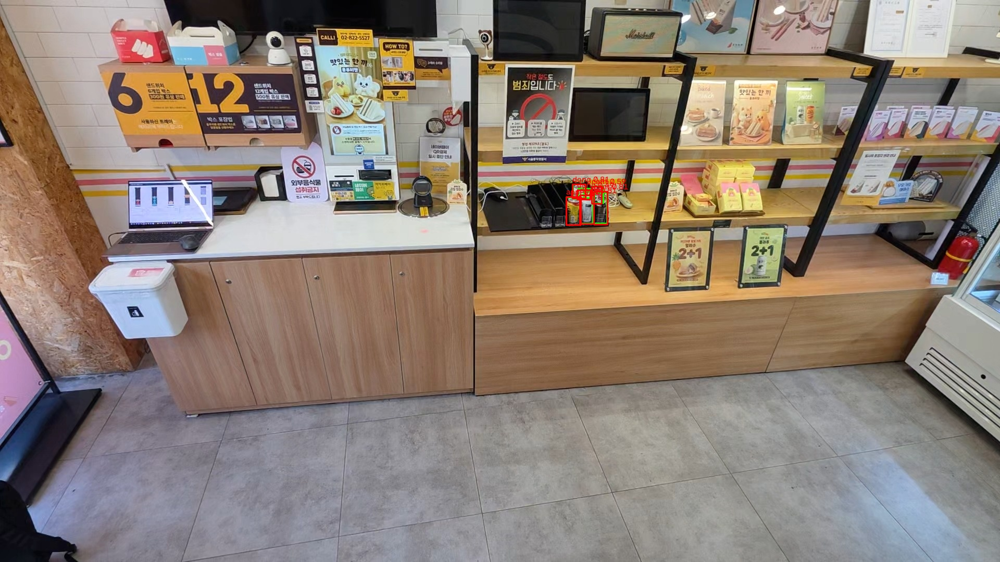 | 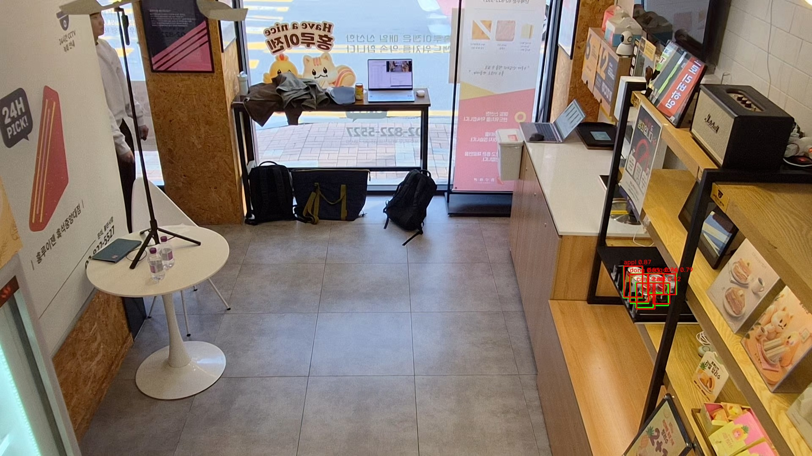 |

**손에 든 상품을 잘 찾은 경우 (yolov8n)**

| 계산대에서 칸타타를 든 장면 (0.89) | 양손에 칸타타·동과루 (0.79 · 0.79) |
|---|---|
| 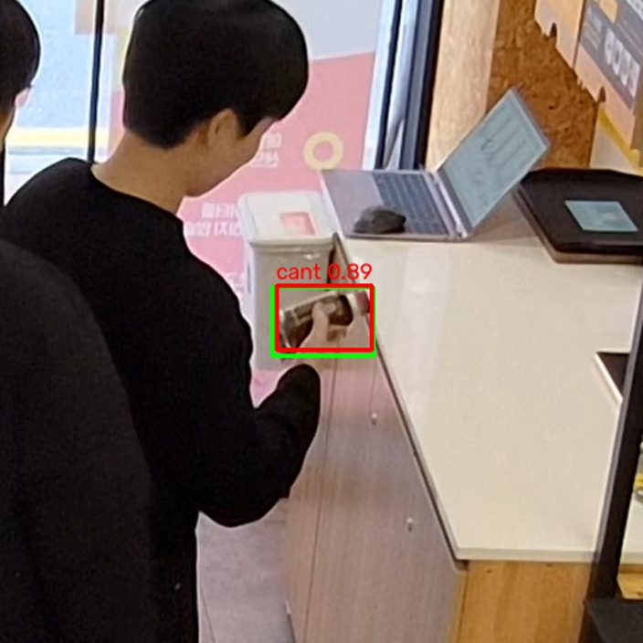 | 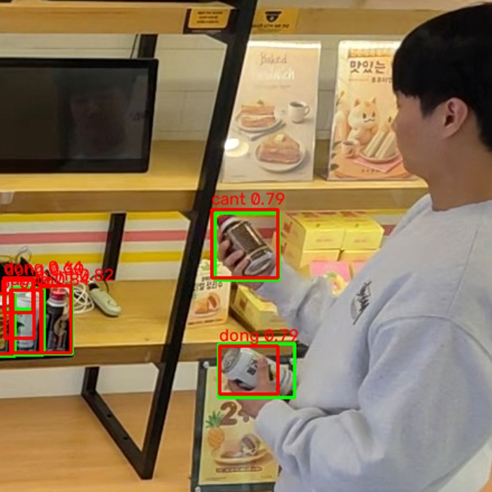 |

**두 모델 모두 놓친 경우**

| 손바닥에 거의 가려진 캔 | 멀리서 작고 흐린 동과루 |
|---|---|
| 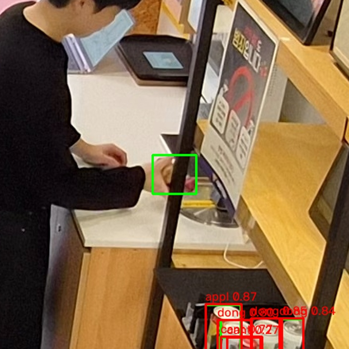 | 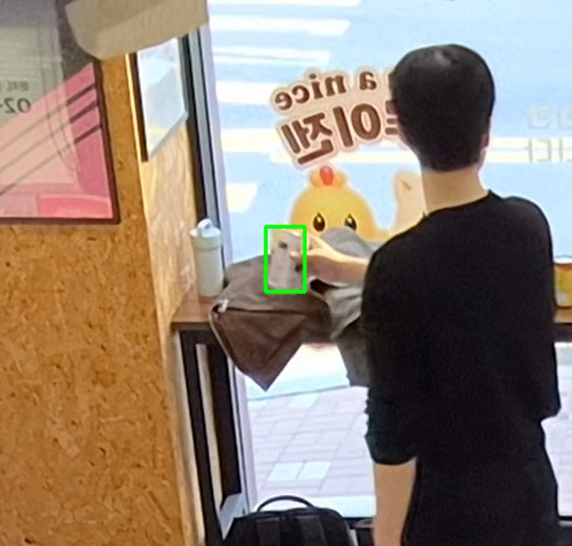 |

**yolov8n은 틀리고 yolov8s는 맞힌 경우**

| yolov8n | yolov8s |
|---|---|
| 손에 든 동과루를 칸타타(0.66)로 봄 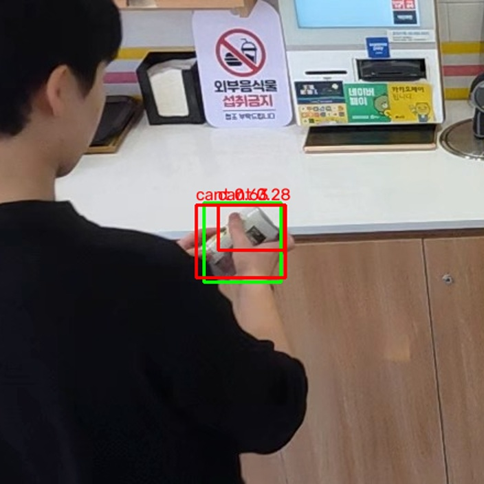 | 동과루로 맞힘 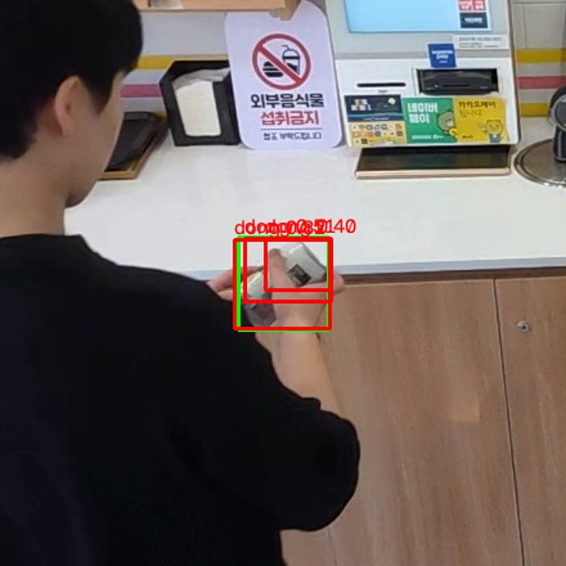 |
| 애플사이다를 동과루(0.28)로 봄 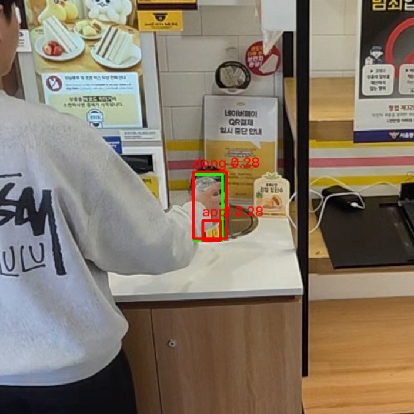 | 애플사이다(0.59)로 맞힘. 단, 안쪽에 작은 상자가 하나 더 생김  |

**yolov8s만 놓친 경우**

| 몸 옆에서 손에 쥐어 거의 안 보이는 칸타타 (n은 찾음) |
|---|
| 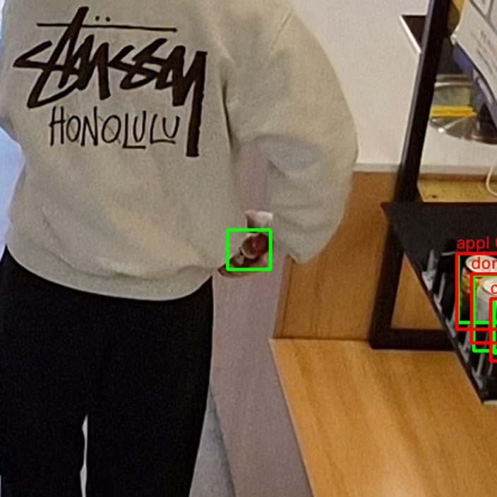 |

**"움직인 상품"에 섞여 들어온 손에 들지 않은 경우**

| 선반 배치가 바뀐 장면 |
|---|
| 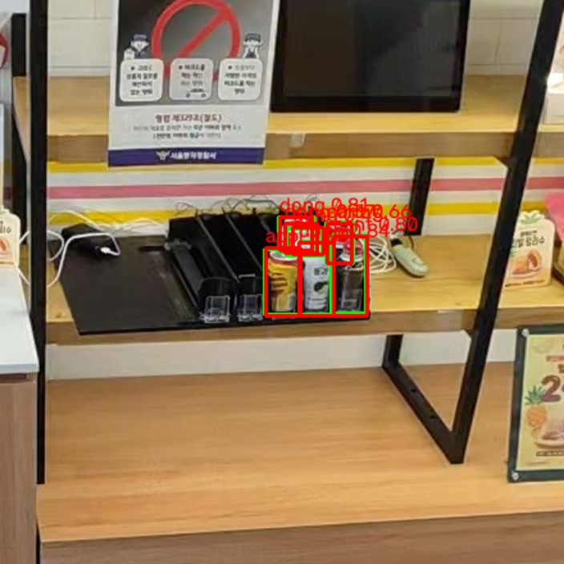 |

---

## 6. 겪은 문제와 처리

1. **numpy 호환성:** 처음 깔린 numpy 2.5에는 `np.trapz`가 없는데, ultralytics 8.3.40은 mAP를 계산할 때 이 함수를 씁니다. numpy를 2.2.6으로 고정해 해결했습니다.
2. **n 학습 후 점수 단계 오류:** 학습은 정상으로 끝났는데, 마지막 점수 계산(시험, 전체 카메라)에서 Windows 데이터 로더 프로세스가 `MemoryError`를 냈습니다.
   - `python train.py --score yolov8n_1280 --workers 2`로 점수만 다시 냈습니다.
   - 그 때문에 `result.json`의 학습 시간이 0으로 적혀서, 로그 값(778초)으로 고치고 `notes`에 경위를 남겼습니다.
   - s는 `--workers 4`로 돌려 문제없이 끝났습니다.
3. **"가장 좋았던 바퀴" 표기 차이:** `train.py` 요약은 mAP50-95만 보고 n의 최고 바퀴를 74로 적습니다. 하지만 실제 `best.pt`는 ultralytics 기준(0.1×mAP50 + 0.9×mAP50-95)으로 **66바퀴째** 모델입니다.
4. 처음 n 학습을 띄울 때 명령어 문법 오류로 시작이 안 돼서, 다시 띄웠습니다. 결과에는 영향이 없습니다.

---

## 7. 한계 (README 원문 포함)

- **데이터 범위:** 매장 한 곳, 같은 날, 같은 카메라 자리, 같은 사람 몇 명입니다. 다른 매장에서 같은 성능이 나온다는 보장은 없습니다.
- **작은 검증 데이터:** 검증은 4편·133장이고, 그중 전체 카메라는 영상 한 편(38장)뿐입니다. 모델 선택이 이 한 편에 치우칠 수 있습니다.
- **라벨 검수:** 라벨을 사람이 눈으로 확인한 것은 일부뿐입니다. 손에 든 상품 표시가 없어서, 5장의 분석은 위치로 추정한 값입니다.
- **선반 뒤쪽 캔:** 절반 넘게 가려진 캔은 라벨을 안 쳐서, 모델이 선반의 개수를 세는 데는 쓸 수 없습니다.
- **시험 점수 사용:** 시험 점수를 두 모델 모두 봤지만, 모델 선택에는 검증 점수만 썼습니다.
- **측정하지 않은 것:** 원래 컴퓨터(CPU)에서의 추론 속도는 재지 않았습니다.

---

## 8. 다음에 해 볼 것

1. **손에 든 장면 데이터 추가:** 특히 애플사이다와, 손에 가려진 캔입니다. 손에 든 상품 인식에는 이게 가장 효과적일 것으로 봅니다.
2. **라벨에 손에 든 표시(H) 채우기:** 그러면 손에 든 상품만 따로 정확히 점수를 낼 수 있습니다.
3. **CPU 추론 속도 재기:** 원래 컴퓨터에서 n과 s의 속도를 재서, 실시간 운용이 가능한지 확인합니다.
4. **yolov8s 더 오래 학습:** 100바퀴 끝까지 조금씩 오르고 있었습니다. 다만 개선 폭은 작을 것으로 봅니다.

---

## 9. 파일 위치

이 저장소에 들어 있는 것 (`training/products/results/`):

| 위치 | 내용 |
|---|---|
| `results/README.md` | 이 문서 |
| `results/images/` | 문서에 쓴 예측 이미지 12장 (`n_` = yolov8n, `s_` = yolov8s) |
| `results/analysis/` | 분석 스크립트 (`predict_test.py` · `per_class.py` · `compare.py`) |
| `results/analysis/val_yolov8n/` · `val_yolov8s/` | 검증 데이터 손에 든 상품 분석 결과 (`summary.json`) |

저장소에 올리지 않은 것 (`.gitignore` 규칙대로 학습한 PC에만 있음):
- **모델 · 학습 기록:** `handoff/yolov8n_1280/`, `handoff/yolov8s_1280/` (`best.pt` · `result.json` · `results.csv` · `args.yaml`), `runs/`
- **예측 이미지 전체:** 시험 293장의 예측 이미지와 확대 이미지 85장씩
- **학습 로그**

이미지에서 초록 상자는 정답, 빨간 상자는 모델 예측입니다.

### 다시 돌리는 법 (`training/products/`에서, 그림을 `dataset/images/`에 둔 뒤)
```
python train.py --model yolov8s.pt                       # 학습
python train.py --score yolov8n_1280 --workers 2         # 점수만 다시
python results/analysis/predict_test.py . <출력폴더> val yolov8s_1280      # 손에 든 상품 분석 (split: val/test, --no-images 로 그림 없이)
python results/analysis/per_class.py handoff/yolov8s_1280/result.json   # 상품별 점수
python results/analysis/compare.py handoff               # 두 모델 점수 비교
```
